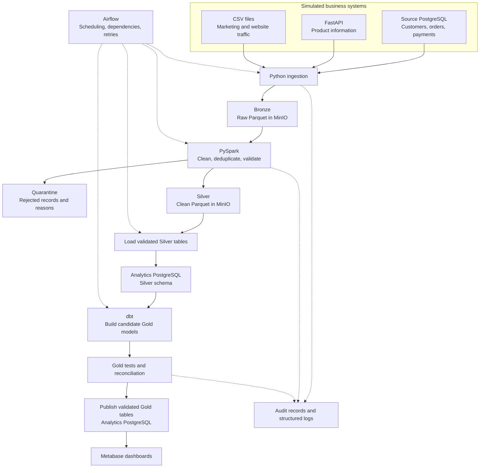

# ShopLakehouse — Architecture

## 1. Project purpose

ShopLakehouse is an e-commerce analytics platform that combines
transactional data, product API data, and marketing CSV files.

It will produce reliable reporting tables for revenue, product
performance, customer behavior, and marketing trends.

We will use synthetic data throughout development.

## 2. Implementation status

This document describes the planned architecture.

Completed foundation work:
- Docker tested with the hello-world container.
- Git repository initialized.
- Python 3.11 virtual environment verified.
- Initial project folders created.

The data services and pipeline components below are not yet implemented.

## 3. Development approach

We will:
1. Build and test a small pipeline locally.
2. Verify its business results.
3. Test AWS-specific integrations in a cloud development environment.
4. Expand the pipeline and automate its operation.
5. Document deployment, monitoring, recovery, and costs.

Local and AWS environments use some different technologies.
Both environments require their own integration tests.

## 4. Local architecture

Solid arrows represent data flow.
Dotted arrows represent orchestration and monitoring.

## 5. Data flow

### Sources

- PostgreSQL stores simulated business transactions.
- FastAPI supplies additional product information.
- CSV files supply daily marketing and website traffic metrics.

The transactional source database is separate from the analytics database.

### Bronze: preserved source data

Python extracts data and writes Parquet files to MinIO.

Bronze preserves source values before business cleaning and includes
metadata such as source name, ingestion timestamp, and batch identifier.

This layer supports investigation and replay.

### Silver: cleaned data

PySpark reads committed Bronze batches and:
- Enforces data types.
- Standardizes timestamps and selected text fields.
- Deduplicates records.
- Validates required fields and business rules.
- Pseudonymizes selected personal information.

Accepted records are written to Silver.
Rejected records are written to quarantine with a rejection reason.

Hashing personal information is pseudonymization, not a guarantee
of anonymization.

### Local analytics loading

A loading step transfers validated Silver records into the Silver
schema of the analytics PostgreSQL database.

This step connects object storage to our local SQL analytics engine.

### Gold: business models

dbt executes SQL against analytics PostgreSQL to create:
- fact_orders: one row per order.
- fact_order_items: one row per order line.
- dim_customer: one row per observed customer version.
- dim_product: one row per product.
- dim_date: one row per calendar date.
- Aggregates for revenue, customer spending, and retention.

Candidate Gold models must pass tests and reconciliation before
publication. The publication mechanism will be implemented explicitly;
running dbt tests alone does not make publication atomic.

### Dashboards

Metabase queries the published Gold tables.

Planned dashboards:
- Executive overview.
- Sales and product performance.
- Customer behavior.

### Orchestration

After the individual stages work, Airflow will coordinate them.

Airflow will manage scheduling, task dependencies, retries, and backfills.
Its metadata database will be separate from business data.

## 6. Core design requirements

| Requirement | Planned behavior |
|---|---|
| Incremental ingestion | Read new and changed records using updated_at |
| Safe checkpoints | Advance watermarks only after successful durable writes |
| Idempotency | Re-running a batch preserves the same published business result |
| Late data | Use an overlap window and explicit backfills |
| Data quality | Reject invalid rows and stop publication when gates fail |
| Reconciliation | Account for accepted, rejected, and deduplicated records |
| Observability | Record counts, timings, batch identifiers, and failures |
| Configuration | Keep environment-specific settings outside application logic |
| Secrets | Keep passwords and tokens out of Git |
| Recovery | Rebuild downstream layers from retained Bronze data |

Additional conventions:
- Store timestamps in UTC.
- Define business reporting days using Asia/Kolkata.
- Use INR for the initial synthetic dataset.
- Use decimal types for money.
- Define revenue, cancellations, and refunds before implementing metrics.
- Customer snapshots preserve observed history; they cannot recover
  versions that were never captured.
- updated_at extraction alone does not capture hard deletes.
  Delete handling must be designed explicitly before claiming support.

## 7. Planned AWS architecture

Target region: ap-south-1.

| Local component | AWS component |
|---|---|
| MinIO | Amazon S3 |
| Source PostgreSQL | Amazon RDS for PostgreSQL |
| Analytics PostgreSQL | Athena with Glue Data Catalog |
| Local Gold tables | Gold Iceberg tables stored in S3 |
| Local container images | Amazon ECR |
| Pipeline containers | ECS Fargate tasks |
| Airflow containers | Airflow services with persistent metadata storage |
| Local environment settings | Environment configuration and Secrets Manager |
| Local logs | CloudWatch logs, metrics, and alarms |
| Infrastructure setup | Terraform |
| AWS access controls | IAM, VPC, security groups, KMS, and TLS |
| AWS activity auditing | CloudTrail |

Glue Data Catalog stores table metadata.
Athena executes SQL against data stored in S3.
dbt submits SQL to the selected database engine.

PostgreSQL and Athena have SQL and adapter differences.
Migration requires integration testing, not just a connection-string change.

The full AWS stack is not assumed to be free.
We will review costs before provisioning resources.

## 8. First implementation milestone

Build a small, verified revenue pipeline:

Source PostgreSQL
→ Bronze in MinIO
→ Silver transformation
→ Analytics PostgreSQL
→ dbt daily revenue model
→ Metabase report

Success means:
- Revenue matches an independently calculated source total.
- Re-running the same batch does not inflate revenue.
- Invalid test records are detected.
- Failures are visible in logs.