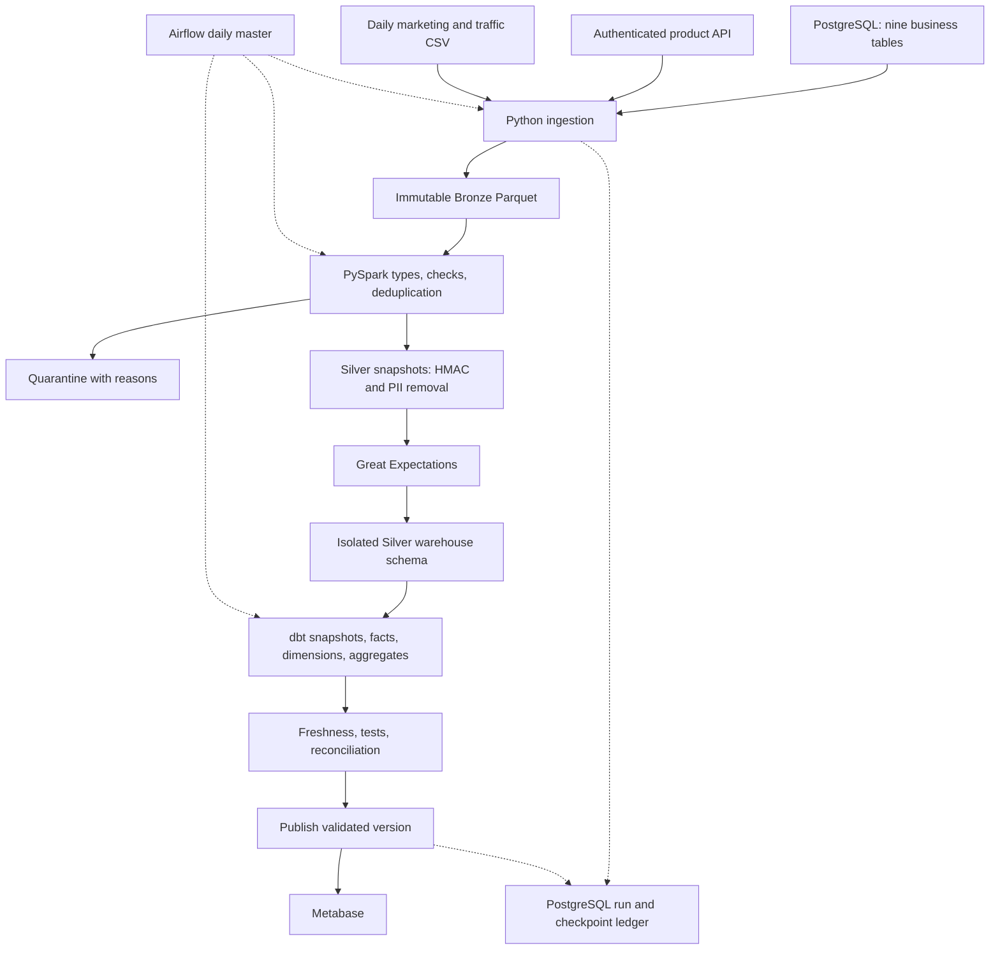
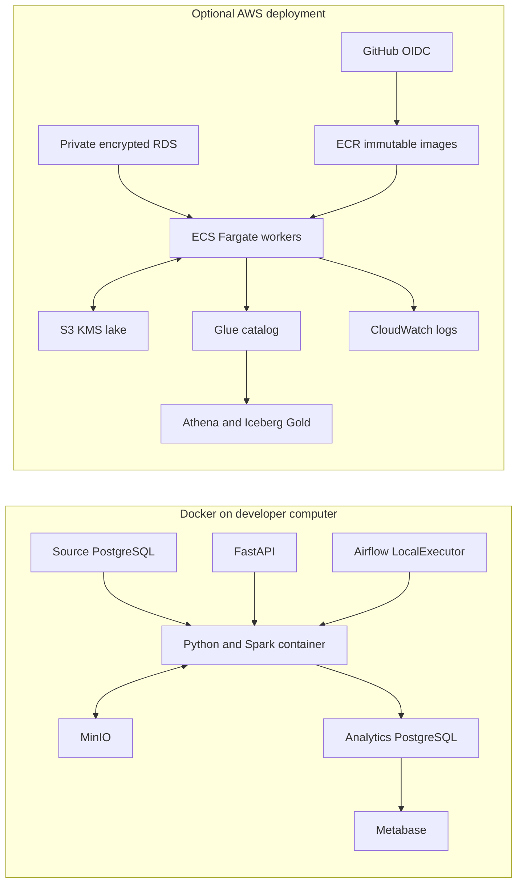

# Architecture and design

## Business objective

Unify operational orders, catalog enrichment and marketing feeds into reproducible reporting. The platform must preserve money accurately, prevent partial results reaching BI, retain evidence of failures and support safe reruns. The demonstration targets daily bounded batches; it has no measured production SLA.

## Logical flow

## Physical deployment

Local PostgreSQL and Athena are different engines. Shared contracts, business SQL/macros and validation logic reduce drift; they do not prove cloud behavior. Athena integration must be validated in a real account before cloud acceptance.

## Decisions

| Tool/design | Reason | Alternative / tradeoff |
|---|---|---|
| PostgreSQL source | Real constraints, transactions and indexed watermarks | CDC captures deletes and transaction order better |
| FastAPI | Reproducible pagination, auth and fault simulation | External API adds uncontrolled availability |
| MinIO → S3 | Same object interface for local/cloud | Local MinIO version is a development dependency |
| PySpark + Parquet | Typed transformations, window dedup, compact portable files | pandas is simpler for very small data |
| dbt | SQL dependencies, tests, lineage and SCD snapshots | Custom SQL runners require more metadata tooling |
| Athena + Glue | Query object data without an always-running warehouse | Redshift suits sustained warehouse workloads |
| Airflow 2 LocalExecutor | Visible scheduling, mapping, retries and pools | Managed Airflow costs more; ECS task executor scales further |
| PostgreSQL control ledger | Transactional publication/checkpoint authority | S3 manifests alone cannot commit multiple catalog views atomically |
| Immutable versioned snapshots | Preserve retry evidence; isolate candidate failures | More storage than in-place partition replacement |
| HMAC-SHA256 | Keyed pseudonymization resists simple dictionary matching | Hashes remain personal data, not anonymization |
| S3 native state locking | Terraform 1.10+ supports lock files | DynamoDB locking is not used; a deliberate modernization |

## Publication contract

Bronze path: entity / ingest date / run ID / attempt ID. Extraction success records durable object metadata but advances no checkpoint. Silver merges the previous published snapshot with the lookback extract, retains the latest key version, validates and writes another immutable object.

Local dbt writes to `b_<run>` from `s_<run>`. Publication replaces all stable `gold` views and checkpoints in one PostgreSQL transaction. Each SQL statement sees a consistent commit; multi-query reports requiring one version should use a repeatable-read transaction or pin the candidate schema.

AWS creates Glue Silver and Iceberg Gold under the run schema. A release manifest is written first; the PostgreSQL publication pointer and checkpoints commit next. Consumers resolve `shoplakehouse release` once and pin that schema. An orphan manifest is not a published release. There is no claim of atomic multi-table Athena view replacement.

## Limits and data semantics

Incremental lookback is seven days by default. Source transactions committing later than that window need a full extraction. Hard deletes are not supported: `--full` refreshes available rows but does not infer deletions. A production CDC/tombstone design is needed for deletions.

The source is not frozen across all extracts. Concurrent writes may cause reconciliation to fail conservatively; retry when writes settle. Historical source states before observation cannot be reconstructed. Customer SCD2 records observed updates and uses an unknown member for orders before observed validity.

Amounts use decimal(18,2), INR. Delivered merchandise revenue is order total after line discounts; refunds and successful payment cash flow are reported separately. Dates are UTC in storage and Asia/Kolkata in reporting. The initial demonstration is intentionally small; one-part snapshots and whole-frame GX validation must be redesigned for 100× scale.
