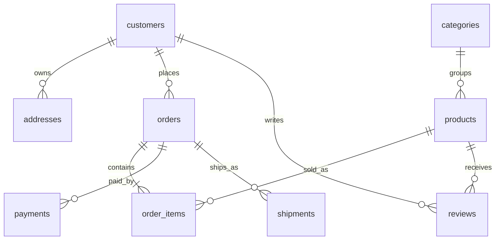
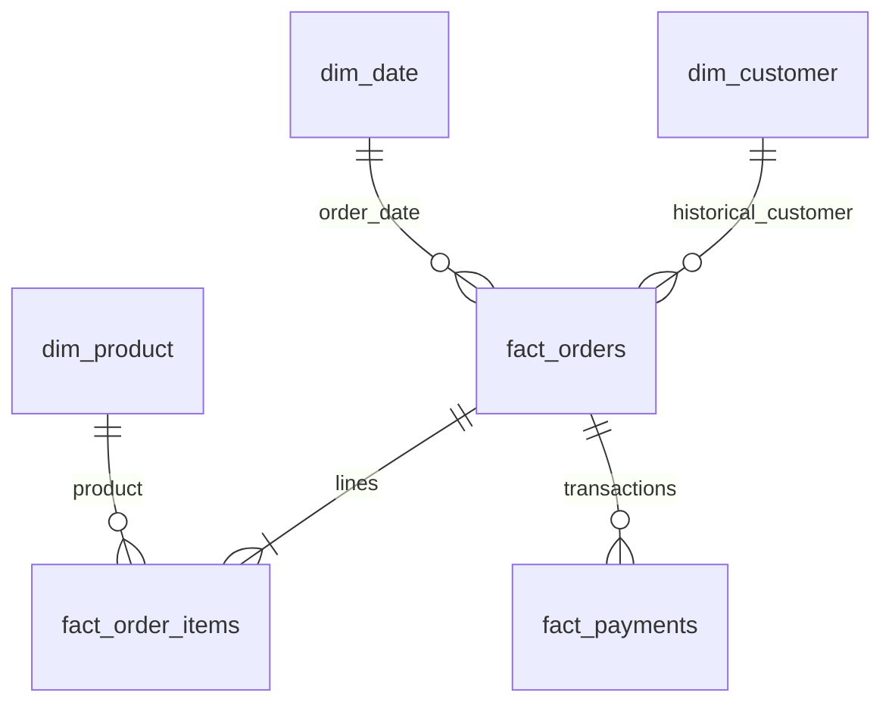

# Data dictionary

Source types are contract/Spark types; timestamps represent UTC and decimal amounts are INR. All source entities use id as their business key. Silver retains the declared columns except listed removals, adds lineage fields and _loaded_at.

## Source relationships

## customers (postgres)

| Column | Type | Required | Meaning / Silver treatment |
|---|---|---|---|
| id | long | yes | Stable source key |
| name | string | yes | Name; HMAC-SHA256 in Silver |
| email | string | yes | Email; HMAC-SHA256 in Silver |
| city | string | yes | City |
| country | string | yes | Two-letter country code |
| created_at | timestamp | yes | Row creation time |
| updated_at | timestamp | yes | Change watermark; source trigger updates it |

Validation rules:
- **email_format**: `email RLIKE '^[^ @]+@[^ @]+[.][^ @]+$'`
- **country_format**: `country RLIKE '^[A-Z]{2}$'`
- **name_not_blank**: `length(trim(name)) > 0`
- **timestamps**: `updated_at >= created_at`

## categories (postgres)

| Column | Type | Required | Meaning / Silver treatment |
|---|---|---|---|
| id | long | yes | Stable source key |
| name | string | yes | Name |
| created_at | timestamp | yes | Row creation time |
| updated_at | timestamp | yes | Change watermark; source trigger updates it |

Validation rules:
- **name_not_blank**: `length(trim(name)) > 0`
- **timestamps**: `updated_at >= created_at`

## products (postgres)

| Column | Type | Required | Meaning / Silver treatment |
|---|---|---|---|
| id | long | yes | Stable source key |
| category_id | long | yes | Category id |
| sku | string | yes | Sku |
| name | string | yes | Name |
| price | decimal(18,2) | yes | Current catalog price |
| stock_quantity | integer | yes | Nonnegative catalog inventory |
| created_at | timestamp | yes | Row creation time |
| updated_at | timestamp | yes | Change watermark; source trigger updates it |

Validation rules:
- **price_nonnegative**: `price >= 0`
- **stock_nonnegative**: `stock_quantity >= 0`
- **sku_not_blank**: `length(trim(sku)) > 0`
- **timestamps**: `updated_at >= created_at`

## addresses (postgres)

| Column | Type | Required | Meaning / Silver treatment |
|---|---|---|---|
| id | long | yes | Stable source key |
| customer_id | long | yes | Customer id |
| address_line1 | string | yes | Address line1; removed from Silver |
| address_line2 | string | no | Address line2; removed from Silver |
| city | string | yes | City |
| state | string | yes | State |
| postal_code | string | yes | Postal code; removed from Silver |
| country | string | yes | Two-letter country code |
| created_at | timestamp | yes | Row creation time |
| updated_at | timestamp | yes | Change watermark; source trigger updates it |

Validation rules:
- **postal_format**: `postal_code RLIKE '^[0-9]{6}$'`
- **country_valid**: `country = 'IN'`
- **timestamps**: `updated_at >= created_at`

## orders (postgres)

| Column | Type | Required | Meaning / Silver treatment |
|---|---|---|---|
| id | long | yes | Stable source key |
| customer_id | long | yes | Customer id |
| ordered_at | timestamp | yes | Order placement instant |
| status | string | yes | Status |
| currency | string | yes | INR |
| total_amount | decimal(18,2) | yes | Sum of item quantity × unit_price − discount_amount |
| created_at | timestamp | yes | Row creation time |
| updated_at | timestamp | yes | Change watermark; source trigger updates it |
| shipping_address_id | long | no | Optional address owned by the order customer |

Validation rules:
- **amount_nonnegative**: `total_amount >= 0`
- **status_valid**: `status IN ('pending','confirmed','shipped','delivered','cancelled')`
- **currency_valid**: `currency = 'INR'`
- **timestamps**: `updated_at >= created_at`

## order_items (postgres)

| Column | Type | Required | Meaning / Silver treatment |
|---|---|---|---|
| id | long | yes | Stable source key |
| order_id | long | yes | Order id |
| product_id | long | yes | Product id |
| line_number | integer | yes | Unique position within an order |
| quantity | integer | yes | Positive units on an order line |
| unit_price | decimal(18,2) | yes | Historical price at sale, independent of catalog changes |
| discount_amount | decimal(18,2) | yes | Discount for the entire line |
| created_at | timestamp | yes | Row creation time |
| updated_at | timestamp | yes | Change watermark; source trigger updates it |

Validation rules:
- **quantity_positive**: `quantity > 0`
- **line_positive**: `line_number > 0`
- **price_nonnegative**: `unit_price >= 0`
- **discount_valid**: `discount_amount >= 0 AND discount_amount <= quantity * unit_price`
- **timestamps**: `updated_at >= created_at`

## payments (postgres)

| Column | Type | Required | Meaning / Silver treatment |
|---|---|---|---|
| id | long | yes | Stable source key |
| order_id | long | yes | Order id |
| payment_reference | string | yes | Unique external reference |
| transaction_type | string | yes | Transaction type |
| payment_method | string | yes | Payment method |
| status | string | yes | Status |
| amount | decimal(18,2) | yes | Positive transaction magnitude; refund direction comes from transaction_type |
| currency | string | yes | INR |
| processed_at | timestamp | no | Successful transaction processing instant |
| created_at | timestamp | yes | Row creation time |
| updated_at | timestamp | yes | Change watermark; source trigger updates it |

Validation rules:
- **amount_positive**: `amount > 0`
- **type_valid**: `transaction_type IN ('payment','refund')`
- **status_valid**: `status IN ('pending','succeeded','failed')`
- **currency_valid**: `currency = 'INR'`
- **processed_valid**: `(status = 'pending' AND processed_at IS NULL) OR (status IN ('succeeded','failed') AND processed_at IS NOT NULL)`
- **timestamps**: `updated_at >= created_at`

## shipments (postgres)

| Column | Type | Required | Meaning / Silver treatment |
|---|---|---|---|
| id | long | yes | Stable source key |
| order_id | long | yes | Order id |
| tracking_number | string | yes | Tracking number |
| carrier | string | yes | Carrier |
| status | string | yes | Status |
| shipped_at | timestamp | no | Shipped at |
| delivered_at | timestamp | no | Delivered at |
| created_at | timestamp | yes | Row creation time |
| updated_at | timestamp | yes | Change watermark; source trigger updates it |

Validation rules:
- **status_valid**: `status IN ('pending','shipped','delivered','returned')`
- **shipped_valid**: `status = 'pending' OR shipped_at IS NOT NULL`
- **delivered_valid**: `status <> 'delivered' OR delivered_at IS NOT NULL`
- **date_order**: `delivered_at IS NULL OR (shipped_at IS NOT NULL AND delivered_at >= shipped_at)`
- **timestamps**: `updated_at >= created_at`

## reviews (postgres)

| Column | Type | Required | Meaning / Silver treatment |
|---|---|---|---|
| id | long | yes | Stable source key |
| customer_id | long | yes | Customer id |
| product_id | long | yes | Product id |
| rating | integer | yes | Integer 1 through 5 |
| review_text | string | no | Review text; removed from Silver |
| created_at | timestamp | yes | Row creation time |
| updated_at | timestamp | yes | Change watermark; source trigger updates it |

Validation rules:
- **rating_valid**: `rating BETWEEN 1 AND 5`
- **timestamps**: `updated_at >= created_at`

## product_api (api)

| Column | Type | Required | Meaning / Silver treatment |
|---|---|---|---|
| id | long | yes | Stable source key |
| sku | string | yes | Sku |
| brand | string | yes | Brand |
| material | string | yes | Material |
| updated_at | timestamp | yes | Change watermark; source trigger updates it |

Validation rules:
- **sku_not_blank**: `length(trim(sku)) > 0`

## marketing (csv)

| Column | Type | Required | Meaning / Silver treatment |
|---|---|---|---|
| id | string | yes | Stable source key |
| event_date | date | yes | CSV business date |
| channel | string | yes | Channel |
| spend | decimal(18,2) | yes | Spend |
| impressions | long | yes | Impressions |
| clicks | long | yes | Clicks |
| updated_at | timestamp | yes | Change watermark; source trigger updates it |

Validation rules:
- **spend_nonnegative**: `spend >= 0`
- **counts_valid**: `impressions >= clicks AND clicks >= 0`

## web_traffic (csv)

| Column | Type | Required | Meaning / Silver treatment |
|---|---|---|---|
| id | string | yes | Stable source key |
| event_date | date | yes | CSV business date |
| channel | string | yes | Channel |
| sessions | long | yes | Sessions |
| conversions | long | yes | Conversions |
| updated_at | timestamp | yes | Change watermark; source trigger updates it |

Validation rules:
- **counts_valid**: `sessions >= conversions AND conversions >= 0`

## Gold relationships

## Gold grain and measures

| Model | Grain | Key measures / semantics |
|---|---|---|
| dim_customer | Customer observed version, plus unknown | HMAC identities, city/country, valid_from inclusive and valid_to exclusive |
| customer_history | Customer SCD version | dbt_scd_id, dbt_updated_at, dbt_valid_from, dbt_valid_to plus cleaned customer fields |
| dim_product | Product | SKU, category, brand/material, current catalog price |
| dim_date | Calendar day (2020–2035) | Year, month, day numbers |
| fact_orders | Order | Historical customer key, placement day, status, INR total |
| fact_order_items | Order item | Quantity, historical unit price, line discount, derived line amount |
| fact_payments | Transaction | Positive amount; successful refund is negative net_cash, unsuccessful is zero |
| daily_revenue | Business day | Delivered merchandise revenue, orders, cancellations, net cash, refunds, AOV |
| customer_ltv | Customer | Observed historical spend, delivered order count, first/last date; not prediction |
| cohort_retention | First-purchase month × month offset | Active customers / original cohort size |
| marketing_performance | Event date × channel | Spend, impressions, clicks, sessions, conversions, CTR and conversion rate |

## Technical tables

| Table | Key | Purpose |
|---|---|---|
| public.schema_migrations | filename | SHA256 checksum and adoption/application evidence |
| public.simulation_batches | batch key | Prevent duplicate synthetic inserts on rerun |
| control.runs | run_id | Lifecycle, cutoff, contract hash, source totals, candidate and validation flag |
| control.table_runs | run_id + entity | Layer paths and extracted/accepted/rejected/duplicate counts |
| control.checkpoints | entity | Last published watermark and Silver object |
| control.publications | singleton | Authoritative published run pointer |

Bronze fields: payload (canonical JSON), _source, _batch_id, _ingested_at (UTC ISO text), _record_hash (SHA256). Quarantine adds reject_reason. Silver keeps lineage and adds _loaded_at (timestamp). SQL migrations are authoritative for source indexes, foreign keys, unique/check constraints and defaults. dbt generated documentation supplies physical output column types after a successful build.
