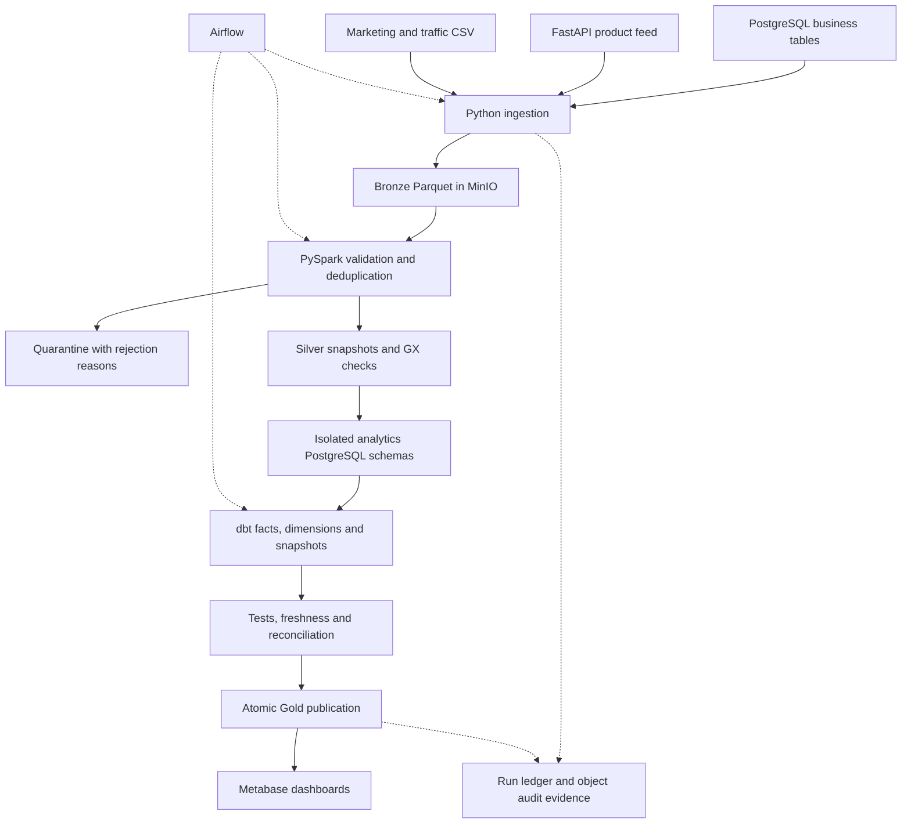

# ShopLakehouse — Project Document

**Owner:** Abhishek Shankar
**Document date:** 13 November 2026
**Status:** Local implementation verified; AWS deployment prepared but not executed.

## 1. Purpose

ShopLakehouse combines an online retailer's transactional database, product API
and marketing files into validated analytical tables. It demonstrates the full
path from source simulation to dashboards, including failures and recovery.

The main reliability requirement is that incomplete or invalid results must not
replace the last good reporting version. A successful transformation is only one
part of that requirement: quality checks, reconciliation and checkpoint updates
must also succeed.

## 2. Scope

| Area | Implementation |
|---|---|
| Business sources | Customers, addresses, categories, products, orders, order items, payments, shipments and reviews |
| External feeds | Paginated product API, marketing CSV and website traffic CSV |
| Simulation | Seeded initial and daily batches, plus opt-in quality faults |
| Bronze | Immutable raw payloads in Snappy Parquet, with ingestion metadata |
| Silver | Typed, deduplicated records; validation, quarantine and PII protection |
| Gold | Facts, dimensions, customer history and business aggregates |
| Orchestration | Five Airflow DAGs with dependencies, retries and a concurrency pool |
| Reporting | Three Metabase dashboards and 24 saved business questions |
| Operations | Run ledger, checkpoints, reconciliation, tests and recovery procedure |
| Cloud preparation | Terraform, Athena/Glue adapter, ECS images and GitHub workflows |

## 3. Architecture

The AWS path replaces MinIO with S3 and the local analytical warehouse with
Glue/Athena. RDS provides source/control databases; ECS runs containers; ECR,
IAM, KMS, Secrets Manager, CloudWatch and CloudTrail support deployment and
operations. Cloud behavior needs real-account integration testing.

## 4. Tool choices

| Tool | Role and rationale |
|---|---|
| Python 3.11 | Shared configuration, extraction, API, simulation and operational CLI |
| PostgreSQL | Transactional source constraints and atomic control/publication state |
| MinIO / S3 | Object storage with a shared local/cloud client interface |
| PySpark | Schema enforcement, window deduplication and transformation |
| Great Expectations | Silver snapshot key and null checks |
| dbt | SQL model dependencies, snapshots, tests and generated documentation |
| Airflow 2 | Scheduled orchestration, task mapping, retries and visibility |
| Metabase | Saved SQL questions and business dashboards |
| Terraform | Reviewable, repeatable infrastructure definitions |
| GitHub Actions | Code checks, container scanning/publishing and reviewed cloud deployment |

Athena was chosen for the cloud path to query object data without an always-on
warehouse. This does not mean the full AWS stack is free: RDS, ECS, NAT, storage
and other services can incur charges.

## 5. Data model and metric definitions

| Gold model | One row represents |
|---|---|
| fact_orders | One order |
| fact_order_items | One line within an order |
| fact_payments | One payment or refund transaction |
| dim_customer | One observed customer version, plus an unknown member |
| dim_product | One current product |
| dim_date | One calendar day |
| daily_revenue | One business day |
| customer_ltv | One customer's observed delivered-order spend |
| cohort_retention | One acquisition month and elapsed-month offset |
| marketing_performance | One date/channel combination |

Amounts are INR decimals. Delivered merchandise revenue is the total of delivered
orders after line discounts. Successful payments and refunds form a separate cash
measure. Historical item prices remain independent of later catalog changes.
Customer LTV is observed historical spend, not a prediction. Storage timestamps
use UTC; reporting dates use Asia/Kolkata.

See [Data dictionary](data-dictionary.md) for columns, validation rules and ERDs.

## 6. Incremental processing and publication

1. Create a run with a unique ID, source cutoff and contract fingerprint.
2. Extract changes using the last published watermark and a seven-day lookback.
3. Write immutable Bronze objects before recording successful extraction.
4. Validate and deduplicate with Spark; retain rejected records and reasons.
5. Merge accepted changes with the last published Silver snapshot and run GX.
6. Load isolated candidate schemas and build/test dbt models and snapshots.
7. Reconcile source order counts and delivered revenue against Gold.
8. Replace local Gold views and advance checkpoints in one transaction.

A failed run leaves the previous publication and checkpoints unchanged. Candidate
mutations invalidate prior Gold validation. AWS publication uses a committed
pointer to a concrete versioned schema; consumers must resolve and pin that version.

## 7. Quality, security and recovery

SQL constraints guard source consistency. Ingestion checks source columns, Spark
checks types and business rules, GX checks Silver snapshots, and dbt checks
relationships and analytical amounts. Strict quality mode allows zero rejections.

Silver uses HMAC-SHA256 for customer names/emails and removes street/postal/free
text fields. Raw Bronze and quarantine still contain sensitive records. Hashing
is pseudonymization, not anonymization. Local secrets remain in ignored `.env`;
the BI database user can read Gold but cannot access the control schema.

Recovery starts by identifying the failed run and its evidence. Repair the cause,
then start a new run for corrected inputs. Never manually advance a watermark to
hide an error. See [Operations runbook](runbook.md) for recovery and retention.

## 8. Verified results

The verification recorded on 13 November 2026 includes:

- 120 synthetic orders: 100 initial and 20 daily.
- Matching source/Gold delivered merchandise revenue of **INR 423,331.25**.
- 51 observed customer versions across 50 customers after the daily update.
- 19 pytest tests passed; the host Airflow import test was skipped and the five
  DAGs were checked separately inside the Airflow image.
- A complete Airflow master DAG test succeeded through publication.
- dbt completed 51 build steps, including 27 data tests, and three freshness checks.
- An unchanged-data rerun preserved totals; an injected failure preserved Gold
  and checkpoints; the clean recovery run published successfully.
- All 24 saved questions executed through Metabase's read-only database connection.
- Python checks, SQL checks and Terraform validation passed; Athena dbt parsed.

These are local demonstration results, not production capacity or availability
claims. [Progress](progress.md) contains run IDs and evidence locations.

## 9. Limitations and deployment boundary

Full snapshots, one-part Parquet output and whole-frame GX validation suit this
bounded dataset. Larger workloads need distributed IO, partitioning, compaction
and incremental validation. Hard-delete propagation and transaction-log CDC are
not implemented. A logical date does not recreate past database state.

AWS resources have not been deployed or billed by this work. Production acceptance
requires real cloud integration, narrower runtime privileges, certificate-verified
TLS, configured notifications and tested backup restoration. Recurring local DAGs
remain paused until explicitly enabled.

## 10. Documentation map

- [Execution steps](execution-steps.md): fresh installation and existing-workspace paths.
- [Architecture](architecture.md): physical/logical design and alternatives.
- [Engineering handbook](handbook.md): detailed concepts and operational tradeoffs.
- [AWS deployment](aws-deployment.md): reviewed cloud rollout and teardown.
- [Portfolio guide](portfolio.md): pitches and project-specific interview answers.
